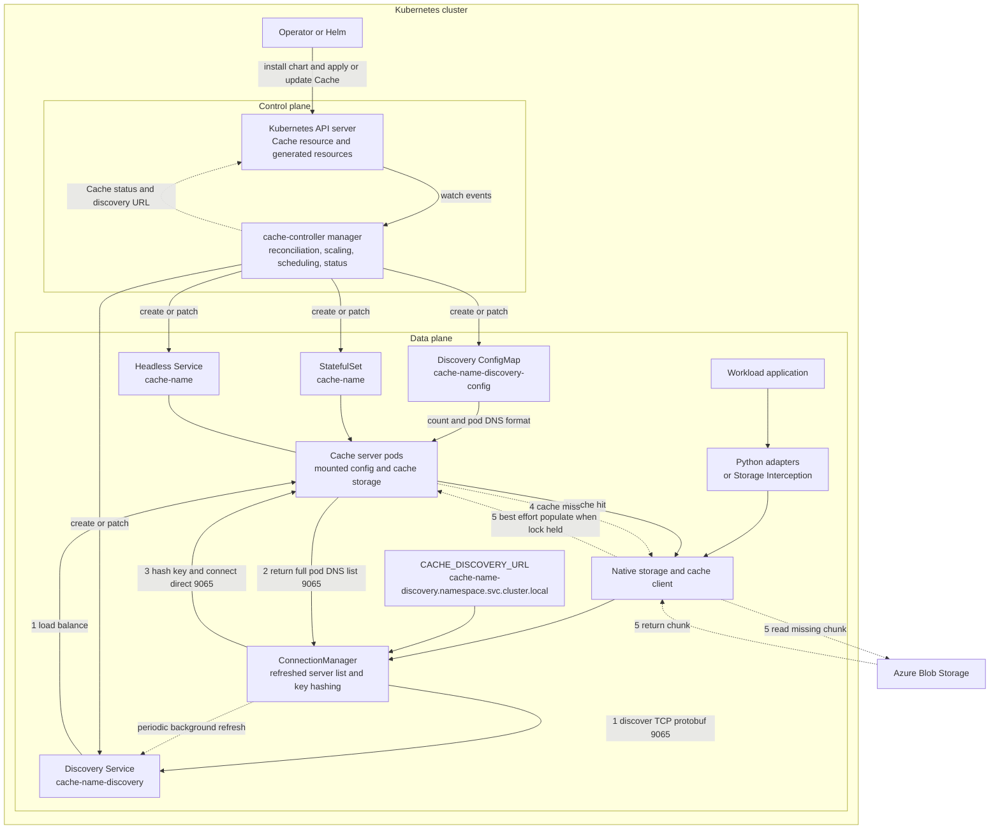

# Architecture

Distributed Accelerator for Cloud Storage (DACS) has two major halves. The
control plane turns a Kubernetes `Cache` resource into a managed set of cache
server pods and discovery resources. The data plane lets applications discover
those pods, choose one by cache key, and send cache traffic directly to it,
with Azure Blob Storage remaining a separate backing-storage path.

## System overview

## Control plane

An operator installs DACS with Helm and applies or updates a `Cache` custom
resource. The Kubernetes API server stores that resource and the objects
generated from it.

The cache-controller manager watches `Cache` resources, their owned
StatefulSets, Services, and ConfigMaps, plus Nodes and cache server Pods. One
manager process contains the reconciliation, scaling, scheduling, and status
behavior shown in the diagram. These are responsibilities within the manager,
not separate deployed services.

For a `Cache` named `cache-name`, the reconciler creates or patches:

- StatefulSet `cache-name`
- Headless Service `cache-name`
- Discovery Service `cache-name-discovery`
- Discovery ConfigMap `cache-name-discovery-config`
- `Cache` status, including the discovery URL and readiness, scaling, and
  scheduling conditions

The StatefulSet pods mount the discovery ConfigMap and their cache storage.
Production deployments typically use node-local NVMe through `hostPath`;
quickstart deployments use `emptyDir` ephemeral storage.

For host-storage mode, scheduling behavior in the manager reads Node and owned
Pod state and binds or reschedules cache server pods. Ephemeral-storage mode
does not set the DACS custom scheduler and therefore uses normal Kubernetes
scheduling.

## Data plane request flow

1. **Discover.** An application enters through the Python DACS client,
   blobfile or boostedblob adapters, or Storage Interception and native file
   APIs. These paths converge on the native storage and cache client.
   `CACHE_DISCOVERY_URL`, or the equivalent client setting, identifies
   `cache-name-discovery.namespace.svc.cluster.local`. `ConnectionManager`
   sends a protobuf `GetCacheServersRequest` over the cache TCP protocol on
   port `9065`. Kubernetes load-balances this discovery request to any cache
   server pod.

2. **Return the server list.** The receiving cache server reads its mounted
   ConfigMap. The ConfigMap contains the server count and the endpoint format
   `cache-name-{}.cache-name.namespace.svc.cluster.local`. The server expands
   that format and returns the full StatefulSet pod DNS list. The Service
   selects a pod; it does not generate the list. A background discovery thread
   periodically refreshes the client's copy.

3. **Select a pod by key.** The client hashes the cache key using consistent
   hashing or static modulo hashing, according to configuration. It then opens
   or reuses a connection directly to the selected StatefulSet pod on port
   `9065`. Normal cache data requests do not continue through the discovery
   Service.

4. **Handle a hit or miss.** On a hit, the selected cache server returns the
   requested chunk from its cache storage. On a miss, the storage client path
   continues to its backing-storage behavior.

5. **Fall back and populate.** `StreamingClient` reads a missing chunk from
   Azure Blob Storage through the remote client and returns it to the
   application. It also stores the chunk in a process-local prefetch cache and,
   when the client owns the cache lock, makes a best-effort upload to the
   distributed cache.

Writes follow the configured write mode. They are not assumed to always update
both the distributed cache and Azure Blob Storage. See the
[DACS Python client](../src/subsystems/storage/dacs_client/README.md) for write
mode configuration.

## Important boundaries

- The Kubernetes API server and cache-controller are not in the application
  data request hot path.
- The discovery Service is for topology discovery, not for proxying normal
  cache data traffic.
- Azure Blob Storage access and cache server access use separate network paths.
- Write behavior is configurable and depends on the selected write mode.

## Related documentation

- [AKS quickstart](quickstart.md)
- [Deployment user guide](../user-guide.md)
- [DACS Python client](../src/subsystems/storage/dacs_client/README.md)
- [Storage Interception](../src/subsystems/storage/storage_intercept/README.md)
- [Cache controller scaling](../src/subsystems/cache-controller/docs/controller/scaling.md)
